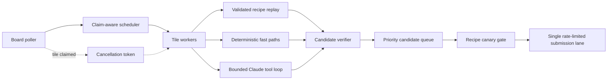

# Jeopardy Agent

Jeopardy Agent is a concurrent, verification-first runtime for the Agent
Jeopardy task race. It polls the playable board, schedules independent tiles
across multiple workers, solves recognized task families deterministically,
falls back to a bounded Claude tool loop, and submits verified candidates
through one rate-limited lane.

The project is optimized for three properties:

- **Speed:** stacked board cells are flattened into independently claimable
  tiles and scheduled by expected yield, claim pressure, and board coverage.
- **Correctness:** candidates must carry evidence and pass structural checks;
  high-value scored answers require a separate verification artifact intended
  to contain an independent check.
- **Bounded execution:** model turns, tool output, archive expansion, HTTP
  access, subprocess resources, retries, and submission rate are constrained.

> [!IMPORTANT]
> This repository includes material derived from an event-provided starter kit
> and does not currently declare an open-source license. Keep it private unless
> the event organizer grants redistribution permission.

## How it works



The model cannot submit answers directly. Its only completion path is
`record_answer`, preferably extracting the exact answer from an internal
artifact so exact-match values do not have to be retyped. Leading and trailing
whitespace are removed from the recorded answer.

See [Architecture](docs/architecture.md) for the full execution model.

## Requirements

- Python 3.12
- Event base URL and team API key
- Local packages: `anthropic`, `httpx`, `requests`, `beautifulsoup4`, `lxml`,
  `numpy`, and `pandas`

The hosted image provides these packages. `requirements.txt` is reserved for
additional dependencies that must be installed during deployment; it is not a
complete local-development dependency file.

## Quick start

### 1. Create a persistent Python 3.12 environment

Using [`uv`](https://docs.astral.sh/uv/getting-started/installation/) (install it
from the official guide first if it is not already available):

```bash
# If uv's default cache is not writable, set this first:
export UV_CACHE_DIR="${TMPDIR:-/tmp}/jeopardy-uv-cache"

uv venv --python 3.12 .venv
uv pip install --python .venv/bin/python \
  anthropic httpx requests beautifulsoup4 lxml numpy pandas
source .venv/bin/activate
```

Or use an already-installed Python 3.12 interpreter:

```bash
python3.12 -m venv .venv
source .venv/bin/activate
python -m pip install \
  anthropic httpx requests beautifulsoup4 lxml numpy pandas
```

Confirm that later bare `python` commands use the activated environment:

```bash
python -c 'import sys; assert sys.version_info[:2] == (3, 12), sys.version'
```

### 2. Run the offline tests

```bash
python -m unittest discover -s tests -v
```

The suite is credential-free and covers scheduling, cancellation, recipe
gating and replay, deterministic handlers, task-scoped tools, transport,
verification, and deployment acceptance checks. This is the only quick-start
workflow that does not contact the event service or model proxy.

### 3. Configure credentials

```bash
cp .env.example .env
```

Edit the two placeholder values in `.env`, then load them into the current
shell:

```bash
source .env
```

`.env` is ignored by Git. Do not put real credentials in `.env.example`, the
source tree, logs, or `agent.zip`.

### 4. Run a bounded live calibration

```bash
RUN_ONCE=1 MAX_TILES=3 FAST_PATH_ONLY=1 DRY_RUN=1 VERBOSE=1 \
  python main.py
```

This mode avoids model calls and answer submission. It still authenticates to
the live event, downloads untrusted task material, makes task-required
event-host requests, and may run deterministic subprocesses. Eligible,
compatible cached recipes are replayed before deterministic handlers. A normal
CLI process starts with an empty replay cache; callers that reuse a populated
solver/cache can observe replay even with fast-path-only mode enabled.

To exercise the model fallback without submitting:

```bash
RUN_ONCE=1 MAX_TILES=3 DRY_RUN=1 VERBOSE=1 \
  MAX_ATTEMPTS=1 RECOVERY_ATTEMPTS=0 python main.py
```

> [!WARNING]
> `DRY_RUN=1` suppresses only `POST /api/submit`. It is not an offline or
> no-cost mode: the agent still reads live data and may use the event model
> proxy. Model-driven `run_python` is not a complete workstation sandbox. Run
> live tasks in the hosted container or another disposable, least-privilege
> environment without sensitive readable files.

## Common run modes

| Mode | Live event reads | Model proxy | Answer submission | Exit behavior |
|---|---:|---:|---:|---|
| Defaults | Yes | When needed | Yes | Follows phase changes indefinitely |
| `RUN_ONCE=1 MAX_TILES=3` | Yes | When needed | **Yes** | Exits after the frozen three-tile workload is terminal |
| Add `DRY_RUN=1` | Yes | When needed | No | Marks verified candidates as dry-run outcomes |
| Add `FAST_PATH_ONLY=1 DRY_RUN=1` | Yes | No | No | Allows eligible replay, then deterministic dispatch; handler misses stop without model fallback |
| Add `TASK_FILTER=A,B` | Yes | Depends on other flags | Depends on `DRY_RUN` | Considers only currently open exact IDs |

```bash
# Long-running agent; follows board phase changes and submits answers
python main.py

# Solve a bounded set and exit
RUN_ONCE=1 MAX_TILES=3 python main.py

# Work only selected open tile IDs
RUN_ONCE=1 TASK_FILTER=PR-W5,PR-C5 python main.py

# Calibrate deterministic handlers in a fresh process without model calls or submissions
RUN_ONCE=1 MAX_TILES=3 FAST_PATH_ONLY=1 DRY_RUN=1 python main.py
```

`RUN_ONCE=1` is a lifecycle control, not a safety control; without `DRY_RUN=1`
it can submit answers. `MAX_TILES` freezes the first selected IDs from the
initial richest-first board view rather than continuously refilling with new
IDs. See [Deterministic solvers](docs/deterministic-solvers.md) for registered
handlers and fast-path failure behavior. `FAST_PATHS` and `FAST_PATH_ONLY`
control handler dispatch and model fallback after the earlier recipe-replay
step; neither flag bypasses replay.

Configuration is environment-based. Defaults, bounds, and operational effects
are documented in [Configuration](docs/configuration.md).

## Build and validate `agent.zip`

The hosted runner expects `main.py` and every imported runtime module at the
archive root. Regenerate the archive explicitly so unrelated repository files
are not included:

```bash
python -m zipfile -c agent.zip \
  main.py jeopardy.py agent_types.py verification.py tool_runtime.py \
  solver.py orchestrator.py fast_paths.py requirements.txt
unzip -l agent.zip
```

Before deployment, verify the archive byte-for-byte against the source and
evaluate archive parity without credentials:

```bash
python -c 'from pathlib import Path; from round2_acceptance import evaluate_archive; r = evaluate_archive(Path("agent.zip"), Path(".").resolve()); print(("PASS" if r.passed else "FAIL"), r.name + ":", r.detail); raise SystemExit(0 if r.passed else 1)'
```

Then evaluate a representative saved run log:

```bash
python round2_acceptance.py \
  --logs /path/to/agent-logs.json \
  --phase practice
```

For a configured hosted agent:

```bash
python round2_acceptance.py --live --phase practice
```

The acceptance command fails closed if run metrics, hosted health, or archive
parity do not meet the configured thresholds. A three-tile smoke log cannot
satisfy the default all-category gate. See [Operations](docs/operations.md) for
the log input contract, CLI flags, exit codes, deployment verification, and
recovery procedure.

## Repository layout

| Path | Responsibility |
|---|---|
| `main.py` | Async entrypoint and fatal authentication handling |
| `jeopardy.py` | Board, task, download, submission, and model-proxy client |
| `orchestrator.py` | Board synchronization, scheduling, retries, recipe gates, and submission lane |
| `solver.py` | Recipe replay, deterministic dispatch, and bounded model tool loop |
| `fast_paths.py` | Fingerprinting and deterministic solvers for recognized generators |
| `tool_runtime.py` | Task-scoped filesystem, archive, Python, HTTP, artifact, and answer tools |
| `verification.py` | Fail-closed candidate validation |
| `agent_types.py` | Shared state, candidates, replay recipes, and cancellation contracts |
| `round2_acceptance.py` | Log, health, latency, outcome, and archive acceptance gates |
| `agent.zip` | Tracked generated deployment archive; members must match the runtime sources byte-for-byte |
| `tests/` | Offline unit and integration tests |
| `.env.example` | Credential placeholders and documented tuning knobs |

## Documentation

- [Architecture](docs/architecture.md) — components, data flow, state, replay,
  scheduling, and cancellation
- [Deterministic solvers](docs/deterministic-solvers.md) — fingerprinting,
  handler inventory, evidence, and fallback behavior
- [Configuration](docs/configuration.md) — required variables and runtime
  tuning
- [Operations](docs/operations.md) — local runs, packaging, deployment,
  acceptance, monitoring, and recovery
- [Security](docs/security.md) — trust boundaries, implemented controls, and
  known limitations
- [Event API reference](docs/event-api.md) — endpoints and response semantics
- [Contributing](CONTRIBUTING.md) — development and verification workflow

## Project status

The runtime and offline suite are complete for the supplied Agent Jeopardy
protocol. A green local suite proves deterministic behavior in the test
harness; it does not prove current event availability, credentials, hosted
health, or scored-round performance. Use the live acceptance gates for those
checks.
