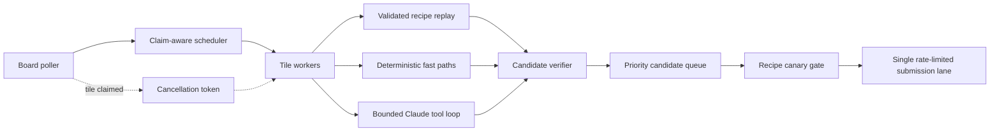

# Jeopardy Agent

Jeopardy Agent is a concurrent, verification-first runtime for the Agent
Jeopardy task race. It polls the playable board, schedules independent tiles
across multiple workers, solves recognized task families deterministically,
falls back to a bounded Claude tool loop, and submits verified candidates
through one rate-limited lane.

The project is optimized for three properties:

- **Speed:** stacked board cells are flattened into independently claimable
  tiles and scheduled by expected yield, claim pressure, and board coverage.
- **Correctness:** candidates must carry evidence and pass structural checks;
  high-value scored answers require an independent verification artifact.
- **Bounded execution:** model turns, tool output, archive expansion, HTTP
  access, subprocess resources, retries, and submission rate are constrained.

> [!IMPORTANT]
> This repository includes material derived from an event-provided starter kit
> and does not currently declare an open-source license. Keep it private unless
> the event organizer grants redistribution permission.

## How it works



The model cannot submit answers directly. Its only completion path is
`record_answer`, preferably extracting the exact answer from an internal
artifact so exact-match values do not have to be retyped.

See [Architecture](docs/architecture.md) for the full execution model.

## Requirements

- Python 3.12
- Event base URL and team API key
- Local packages: `anthropic`, `httpx`, `requests`, `beautifulsoup4`, `lxml`,
  `numpy`, and `pandas`

The hosted image provides these packages. `requirements.txt` is reserved for
additional dependencies that must be installed during deployment.

## Quick start

### 1. Configure credentials

```bash
cp .env.example .env
```

Edit the two placeholder values in `.env`, then load them into the current
shell:

```bash
source .env
```

`.env` is ignored by Git. Do not put real credentials in `.env.example`, the
source tree, logs, or `agent.zip`.

### 2. Run a safe local smoke test

Using `uv`:

```bash
uv run -p 3.12 \
  --with anthropic,httpx,requests,beautifulsoup4,lxml,numpy,pandas \
  env RUN_ONCE=1 MAX_TILES=3 DRY_RUN=1 VERBOSE=1 python main.py
```

Or create a virtual environment:

```bash
python3.12 -m venv .venv
source .venv/bin/activate
pip install anthropic httpx requests beautifulsoup4 lxml numpy pandas
RUN_ONCE=1 MAX_TILES=3 DRY_RUN=1 VERBOSE=1 python main.py
```

`DRY_RUN=1` performs solving and verification but does not call the submission
API. Remove it only when you intend to submit answers.

### 3. Run the tests

```bash
python -m unittest discover -s tests -v
```

The suite is credential-free and covers scheduling, cancellation, recipe
gating and replay, deterministic handlers, task-scoped tools, transport,
verification, and deployment acceptance checks.

## Common run modes

```bash
# Long-running agent; follows board phase changes and submits answers
python main.py

# Solve a bounded set and exit
RUN_ONCE=1 MAX_TILES=3 python main.py

# Work only selected open tile IDs
RUN_ONCE=1 TASK_FILTER=PR-W5,PR-C5 python main.py

# Exercise deterministic handlers without model calls or submissions
RUN_ONCE=1 MAX_TILES=3 FAST_PATH_ONLY=1 DRY_RUN=1 python main.py
```

Configuration is environment-based. Defaults, bounds, and operational effects
are documented in [Configuration](docs/configuration.md).

## Build and validate `agent.zip`

The hosted runner expects `main.py` and every imported runtime module at the
archive root. Regenerate the archive explicitly so unrelated repository files
are not included:

```bash
python -m zipfile -c agent.zip \
  main.py jeopardy.py agent_types.py verification.py tool_runtime.py \
  solver.py orchestrator.py fast_paths.py requirements.txt
unzip -l agent.zip
```

Before deployment, verify the archive byte-for-byte against the source and
evaluate a saved run log:

```bash
python round2_acceptance.py \
  --logs /path/to/agent-logs.json \
  --phase practice
```

For a configured hosted agent:

```bash
python round2_acceptance.py --live --phase practice
```

The acceptance command fails closed if run metrics, hosted health, or archive
parity do not meet the configured thresholds. See
[Operations](docs/operations.md).

## Repository layout

| Path | Responsibility |
|---|---|
| `main.py` | Async entrypoint and fatal authentication handling |
| `jeopardy.py` | Board, task, download, submission, and model-proxy client |
| `orchestrator.py` | Board synchronization, scheduling, retries, recipe gates, and submission lane |
| `solver.py` | Recipe replay, deterministic dispatch, and bounded model tool loop |
| `fast_paths.py` | Fingerprinting and deterministic solvers for recognized generators |
| `tool_runtime.py` | Task-scoped filesystem, archive, Python, HTTP, artifact, and answer tools |
| `verification.py` | Fail-closed candidate validation |
| `agent_types.py` | Shared state, candidates, replay recipes, and cancellation contracts |
| `round2_acceptance.py` | Log, health, latency, outcome, and archive acceptance gates |
| `tests/` | Offline unit and integration tests |
| `.env.example` | Credential placeholders and documented tuning knobs |

## Documentation

- [Architecture](docs/architecture.md) — components, data flow, state, replay,
  scheduling, and cancellation
- [Configuration](docs/configuration.md) — required variables and runtime
  tuning
- [Operations](docs/operations.md) — local runs, packaging, deployment,
  acceptance, monitoring, and recovery
- [Security](docs/security.md) — trust boundaries, implemented controls, and
  known limitations
- [Event API reference](docs/event-api.md) — endpoints and response semantics
- [Contributing](CONTRIBUTING.md) — development and verification workflow

## Project status

The runtime and offline suite are complete for the supplied Agent Jeopardy
protocol. A green local suite proves deterministic behavior in the test
harness; it does not prove current event availability, credentials, hosted
health, or scored-round performance. Use the live acceptance gates for those
checks.
